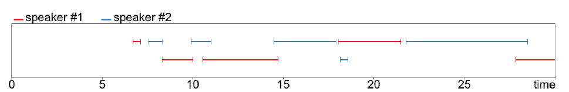
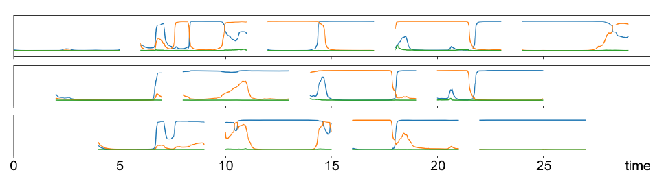
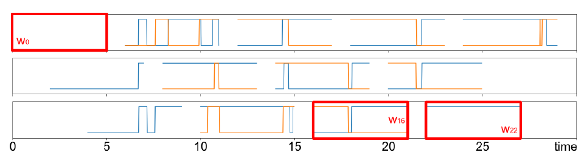
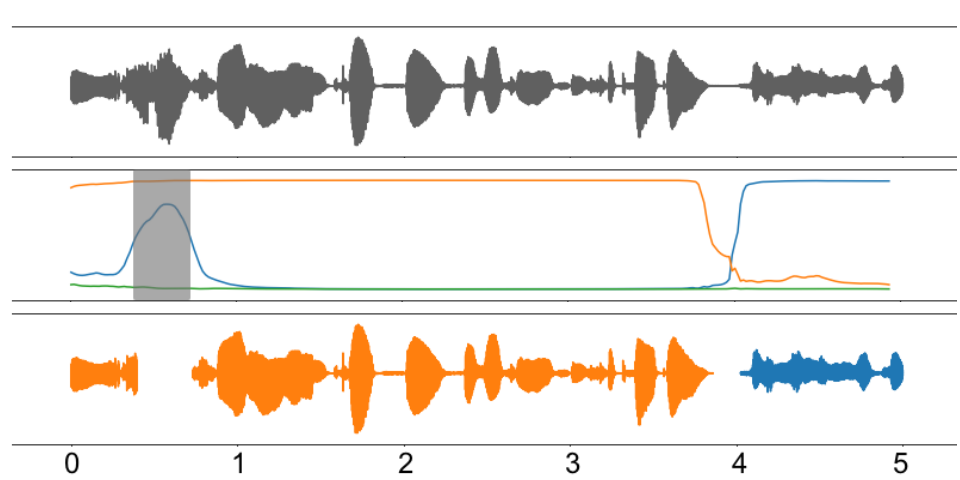
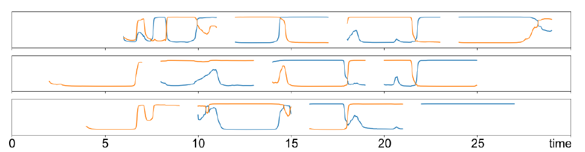
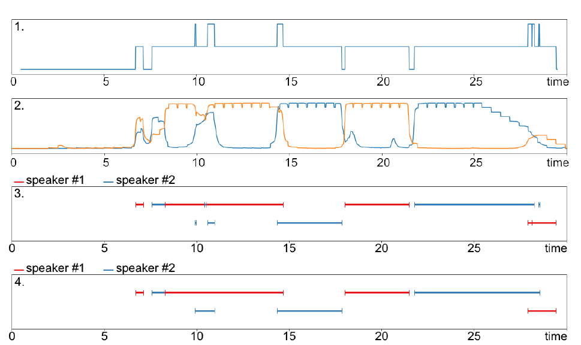

# 【pyannote.audio 2.1 speaker diarization pipeline：principle, benchmark, and recipe】

<center><b>表 1：論文基本資訊</b></center>

| 項目 | 內容 |
|---|---|
| 作者 | Hervé Bredin（法國土魯斯大學 IRIT / CNRS） |
| 發表 | INTERSPEECH 2023（Dublin），pp. 1983–1987 |
| 連結 | [HAL](https://hal.science/hal-04247212v1)・[PDF（ISCA）](https://www.isca-archive.org/interspeech_2023/bredin23_interspeech.pdf)・[DOI](https://doi.org/10.21437/Interspeech.2023-105)・[GitHub](https://github.com/pyannote/pyannote-audio)・[預先算好的結果](https://hf.co/pyannote/speaker-diarization/tree/2.1.1) |
| 引用（IEEE） | H. Bredin, "pyannote.audio 2.1 speaker diarization pipeline: Principle, benchmark, and recipe," in *Proc. Interspeech*, Dublin, Ireland, 2023, pp. 1983–1987, doi: 10.21437/Interspeech.2023-105. |
| 動畫解說 | [papers.poyuanchu.com/2023-bredin-pyannote21/](https://papers.poyuanchu.com/2023-bredin-pyannote21/) |
| 論文類型 | 工具包論文：說明開源工具 pyannote.audio 2.1 的語者分段流程、在 11 個資料集上的基準結果，以及調整到自己資料的做法 |
| 比賽成績 | Ego4D 2022 第 1 名、Albayzin 2022 第 1 名、VoxSRC 2022 第 6 名 |
| 狀態 | 待讀 |
| 與我的相關度 | 3 / 5（語音領域；但「預訓練流程 + 依資料量選擇調整方式」的落地思路很通用） |
| 加入日期 | 2026-11-11 |

> [!NOTE]
> **一句話**：pyannote.audio 2.1 把語者分段拆成四步：**先在 5 秒小視窗裡分段、再替每個說話者抽聲紋、接著把整段對話分群、最後合併輸出**。它開箱就能用，作者還給了一份「依你手上有多少標註資料，該怎麼調」的食譜。

> [!TIP]
> 這篇是之前讀過的 Powerset 論文的**基礎**：Powerset 論文就是在這條流程上，只換掉第一步分段模型的損失函數。先讀這篇，再回頭看 Powerset 會更清楚。

---

## 1. 背景與定位

### 語者分段在做什麼

語者分段（speaker diarization）要回答：「**一段錄音裡，誰在什麼時候說話？**」輸出是一條時間軸，標出每個說話者說話的區段，不需要知道真實身分。

### 兩派做法

- **傳統流水線**：語音偵測 → 抽聲紋 → 分群。好處是能處理任意長度、任意人數；缺點是不擅長兩人同時說話
- **端到端神經網路（EEND）**：一個網路直接輸出誰在說話，能處理重疊，但人數多、錄音長就吃力

pyannote.audio 2.1 和日本 NTT 的 Kinoshita 等人的路線類似，**結合兩派**：先用神經網路處理短片段（擅長重疊），再用分群把片段接起來（能處理長錄音、人數不定）。

### 和 NTT 做法的兩個差別

1. **視窗更短、重疊更多**：NTT 用 30 秒視窗、不重疊；本文用 **5 秒視窗、每 0.5 秒移動一次**。好處是：
   - 每個視窗裡的人數上限變小（最多 3 人），訓練序列也變短，**省運算和記憶體**
   - 視窗大量重疊，等於**測試時做了資料增強**（同一段聲音被看了很多次），分段更準，抽出的聲紋也更密集、更好分群
2. **分段和聲紋用兩個獨立網路**：NTT 用一個網路同時做兩件事。作者認為分開比較好調整，因為訓練聲紋網路需要**大量說話者、而且跨對話標籤一致**的資料，一般使用者很難準備；分開後，聲紋模型可以直接用別人預訓練好的

---

## 2. 原理：四個步驟

作者全篇用同一段 30 秒、兩人對話的錄音示範。

<center>

<br>
<b>圖 1：示範錄音的標準答案（人工標註的語者分段結果，原論文 Figure 1）</b>
</center>

> [!NOTE]
> **圖 1 怎麼看**
> 橫軸是時間（0–30 秒）。**紅色是說話者 #1、藍色是說話者 #2**，每條橫線是一段說話區間；上下兩排只是為了避免線段重疊，看起來比較清楚。
> - 前 6 秒沒人說話
> - 約 7–15 秒兩人輪流、短句交錯
> - 約 18 秒附近藍色有一小段插話，和紅色重疊
> - 後半段是兩段較長的獨白，最後紅色又接一句
>
> 這就是整條流程**最後要產出的樣子**，後面每張圖都在說明怎麼一步步逼近它。

### 2.1 第一步：在小視窗裡分段（Local neural speaker segmentation）

用作者先前的端到端分段模型，以 **5 秒視窗、每 0.5 秒滑動一次**掃過整段錄音。每個視窗裡，模型對最多 $K_{max}=3$ 個說話者，**每 16 毫秒**輸出一次「此人正在說話」的機率。

<center>

<br>
<b>圖 2：小視窗分段模型的輸出（原論文 Figure 2）</b>
</center>

> [!NOTE]
> **圖 2 怎麼看**
> 每一小段曲線是**一個 5 秒視窗**的輸出，三種顏色是模型內部的三個「說話者欄位」（藍、橙、綠），高度是該欄位在說話的機率。
> - 為了好讀，圖中視窗每 **2 秒**畫一個，並錯開放在三排；實際上每 0.5 秒就有一個視窗，彼此大量重疊
> - 綠色幾乎都貼在底部：這段對話只有兩個人，第三個欄位大多沒用到
> - 注意**同一個真實說話者在不同視窗可能被分到不同顏色**。例如約 16 秒附近，前後兩個視窗對同一個人用了不同欄位
>
> 這是因為模型用「排列不變」的方式訓練：它只保證「同一視窗內分得開」，不保證「跨視窗用同一個編號」。所以後面還需要分群把它們對起來。

接著用門檻 $\theta$ 把機率轉成「有說／沒說」（二值化），這是整條流程的**第一個超參數**。

<center>

<br>
<b>圖 3：二值化後的小視窗分段結果（原論文 Figure 3）</b>
</center>

> [!NOTE]
> **圖 3 怎麼看**
> 和圖 2 一樣的視窗排列，但曲線變成只有高、低兩種狀態的方波：機率超過 $\theta$ 才算「有在說話」。每個視窗 $w$ 最後留下 $K_w \in \{0,1,2,3\}$ 個說話者。紅框是三個例子：
> - $w_0$（0–5 秒）：**沒有任何人**超過門檻，$K_w=0$
> - $w_{16}$（16–21 秒）：橙、藍**兩人**都有說話，$K_w=2$
> - $w_{22}$（22–27 秒）：只有藍色**一人**，$K_w=1$

### 2.2 第二步：替每個說話者抽聲紋（Local speaker embedding）

每個視窗裡有幾個人在說話，就抽幾個聲紋向量，所以**每個視窗抽出的數量不固定**（0、1、2 或 3 個）。

<center>

<br>
<b>圖 4：如何從一個 5 秒視窗抽出每位說話者的聲紋（原論文 Figure 4）</b>
</center>

> [!NOTE]
> **圖 4 怎麼看**
> 三排由上到下：
> - **上排（灰色）**：這個 5 秒視窗的原始聲波
> - **中排**：分段模型的輸出。橙色幾乎全程在說話，藍色在最後約 1 秒開口；**灰色區塊**（約 0.4–0.7 秒）是藍色的機率短暫升高、和橙色重疊的地方；綠色一直貼底，從沒超過門檻
> - **下排**：真正拿去抽聲紋的聲音。橙色的聲紋只用「**橙色在說、而且其他人都沒在說**」的片段接起來算（注意灰色重疊那一段被挖掉了）；藍色只用最後那段；綠色沒有任何片段，所以**不抽聲紋**
>
> 關鍵是**重疊的部分不拿來抽聲紋**，避免兩個人的聲音混在一起污染聲紋。

和常見做法（固定每 1–2 秒切一段抽一個聲紋）相比，作者認為這樣抽出的聲紋**更可靠**：

1. **只包含單一說話者的聲音**；固定切段可能混進其他人或沒人說話的片段
2. **片段可能更長**：如果某人整個視窗都在說，最長可用 5 秒；固定切段只有 1–2 秒

> [!WARNING]
> 代價是：聲紋品質**依賴第一步的分段結果**。如果分段模型判斷錯了，抽出的聲紋也會跟著變差。

### 2.3 第三步：整段對話分群（Global agglomerative clustering）

把所有視窗抽出的聲紋放在一起分群，讓每個「視窗內的說話者」對應到一個「整段對話的說話者」。

<center>

<br>
<b>圖 5：分群之後的小視窗分段結果（原論文 Figure 5）</b>
</center>

> [!NOTE]
> **圖 5 怎麼看**
> 和圖 2 是同樣的曲線，但**顏色重新上色了**：現在顏色代表分群後的「整段對話說話者」，只剩兩種（橙、藍）。對照圖 2，原本在不同視窗被分到不同欄位的同一個人，現在**跨視窗都是同一個顏色**，也就是編號對起來了。

作者選擇最傳統的**階層式聚合分群**（agglomerative hierarchical clustering），用**質心連結**（centroid linkage，又叫 UPGMC：兩群的距離以各自中心點的距離計算），而不是近年流行的譜分群（spectral clustering）或變分貝氏隱馬可夫模型（VBx），原因有兩個：

1. **只多一個超參數**：停止合併的距離門檻 $\delta$（整條流程的**第二個超參數**）；另外兩種方法至少要調好幾個
2. **不需要固定節奏的聲紋**：VBx（以及某種程度上的譜分群）假設聲紋**按時間順序、固定間隔**排好（例如每秒一個）；但這條流程每 0.5 秒可能抽出 0、1 或多個聲紋，不符合這個假設

至於連結方式，作者在每一個驗證集上比較過，**質心連結都比平均、單一、完全、Ward 連結好**，第二名是較常用的平均連結。

### 2.4 第四步：合併成最終結果（Final aggregation）

<center>

<br>
<b>圖 6：最終合併的四個步驟（原論文 Figure 6）</b>
</center>

> [!NOTE]
> **圖 6 怎麼看**
> 由上到下對應下面的四個小步驟：
> 1. **估計每一刻有幾個人在說話**：把所有重疊視窗的二值化結果加總平均、四捨五入。曲線是階梯狀，大多在 1（一人），偶爾跳到 2（兩人重疊），開頭是 0
> 2. **每個說話者每一刻的分數**：把分群後的結果在重疊視窗間加總。橙、藍兩條曲線輪流在上面，代表誰比較可能在說話
> 3. **取前幾名**：每一刻依步驟 1 的人數，選分數最高的那幾個人，轉回時間軸。紅、藍線段已經很接近圖 1 的答案，但還有一些很短的碎片和小空隙
> 4. **補小空隙**：同一個人中間停頓短於 $\Delta$ 的地方直接連起來，得到最終結果，和圖 1 幾乎一樣

第 4 步是可選的，$\Delta$ 是**第三個超參數**。作者指出，$\Delta$ 該設多少，**取決於當初標註員收到的規則，而不是資料本身**：

<center><b>表 2：不同資料集對「多短的停頓不算斷句」的規定</b></center>

| 資料集 | 標註規則 |
|---|---|
| DIHARD | 同一人停頓短於 200 毫秒，不算斷開 |
| VoxConverse | 停頓超過 250 毫秒才切開 |
| Albayzin 2022 | 同一人兩段之間沉默少於 2 秒，視為同一段 |

---

## 3. 可重現的基準測試

### 作者對現況的批評

作者直言（還為語氣道歉）：語者分段的研究**很難互相比較**，原因包括：

- 有些論文只在**要付費**的資料集（CALLHOME、DIHARD、REPERE）、合成資料、甚至**公司內部資料**上報結果，其他人無從比較
- 即使用同一個資料集，**實驗設定也常不同而不自知**：測試集清單略有差異、標準答案版本不同、評分時有沒有容忍邊界誤差（forgiveness collar）、是否假設語音偵測完全正確（oracle VAD）

作者呼籲：**至少公開系統的實際輸出**（業界標準的 RTTM 格式），並且提供程式碼，讓任何人都能在自己的資料（包括私有資料）上重跑。

只要幾行程式就能從音檔產出 RTTM：

```python
# install pyannote.audio
pip install pyannote-audio==2.1.1

# load pretrained pipeline
from pyannote.audio import Pipeline
pipeline = Pipeline.from_pretrained("pyannote/speaker-diarization")

# apply pipeline and dump RTTM
diarization = pipeline("audio.wav")
with open("audio.rttm", "w") as f:
    diarization.write_rttm(f)
```

<center><b>圖 7：從零到 RTTM 的程式碼（原論文 Figure 7）</b></center>

### 測試設定

為了公平，作者用**最嚴格**的設定：

- **完全自動**：不給正確的語音段、不給正確人數、不針對各資料集調整模型或超參數
- **最不寬容的 DER**：沒有容忍邊界，**重疊說話也算分**
- 11 個資料集的官方測試集

### 速度與聲紋模型的選擇

- 用一張 NVIDIA V100 GPU 跑神經網路（第 1、2 步）、一顆 Intel CPU 跑分群與合併（第 3、4 步），**比即時快 40 倍**，大部分時間花在抽聲紋
- 聲紋模型比較了四種開源實作，在 VoxConverse 上的 DER：

<center><b>表 3：不同聲紋模型在 VoxConverse v0.3 上的 DER（已微調流程）</b></center>

| 聲紋模型 | DER |
|---|---|
| pyannote.audio 內建 x-vector | 14.9% |
| NeMo 的 TitaNet | 12.0% |
| RawNet3 | 10.8% |
| **SpeechBrain 的 ECAPA-TDNN** | **10.7%** |

所以所有實驗都用 SpeechBrain 的 ECAPA-TDNN。

---

## 4. 食譜：依資料量選擇調整方式

預訓練流程開箱就能用，但如果你有自己的標註資料，可以依資料多寡選擇：

<center><b>表 4：依標註資料量選擇調整方式</b></center>

| 你有的資料 | 建議做法 | 調整什麼 |
|---|---|---|
| 少量標註對話（開發集，幾個到幾十個檔案） | **只調超參數** | $\theta$、$\delta$、$\Delta$ |
| 較多標註對話（訓練集，幾小時以上） | **微調分段模型**，再調超參數 | 第一步的神經網路 |
| 某領域的大量資料 | 微調聲紋模型 | 超出本文與 pyannote.audio 範圍（聲紋模型來自外部套件） |

### 4.1 只調超參數

```python
# load dataset with pyannote.database
from pyannote.database import get_protocol
dataset = get_protocol(...)
dev_files = list(dataset.development())

# optimize hyper-parameters with pyannote.pipeline
from pyannote.pipeline import Optimizer
optimizer = Optimizer(pipeline)
optimizer.tune(dev_files)

# apply optimized pipeline
diarization = optimizer.best_pipeline("audio.wav")
```

<center><b>圖 8：用 pyannote.pipeline 最佳化超參數（原論文 Figure 8）</b></center>

### 4.2 微調分段模型

```python
# load pretrained model
from pyannote.audio import Model
model = Model.from_pretrained("pyannote/segmentation")

# prepare model for fine-tuning
from pyannote.audio.tasks import Segmentation
model.task = Segmentation(dataset)

# fine-tune model with pytorch-lightning
from pytorch_lightning import Trainer
trainer = Trainer()
trainer.fit(model)
```

<center><b>圖 9：用 PyTorch Lightning 微調分段模型（原論文 Figure 9）</b></center>

---

## 5. 結果

資料集分成兩組：

- **領域內**（in domain）：訓練分段模型時用過它們的訓練資料
- **領域外**（out of domain）：分段模型沒看過

DER 由兩部分組成：**CONF**（認錯人）、**FA+MISS**（誤報 + 漏抓）。

<center><b>表 5：三種設定在 11 個資料集上的 DER（%，越低越好；節錄原論文 Table 1）</b></center>

| 資料集 | 預設流程 | + 調超參數 | + 微調分段模型 | 文獻最佳（2023/2） |
|---|---|---|---|---|
| AISHELL-4 | 14.1 | **14.0** | 14.5 | 16.1 |
| AMI headset mix | 18.9 | 18.9 | **18.5** | 19.0 |
| DIHARD 3 full | 26.9 | 22.2 | 21.9 | **16.8** |
| REPERE phase 2 | **8.2** | 8.3 | 8.3 | 12.6 |
| VoxConverse v0.3 | 11.2 | 10.8 | **10.7** | — |
| **領域內平均** | 15.9 | **14.8** | **14.8** | |
| Albayzin/RTVE 2022 | 25.6 | 23.1 | **21.8** | — |
| AliMeeting ch.1 | 27.4 | 29.0 | 23.8 | **23.5** |
| AMI array 1 ch.1 | 27.1 | 25.9 | **22.2** | 23.7 |
| CALLHOME part 2 | 32.4 | 32.4 | 29.3 | **21.8** |
| Ego4D v1（驗證集） | 64.0 | 60.3 | **51.8** | 67.2 |
| This American Life | 20.8 | 18.4 | **15.2** | 25.0 |
| **領域外平均** | 32.9 | 31.5 | **27.4** | |
| **整體平均** | 25.2 | 23.9 | **21.6** | |

各資料集用來調整的資料量差很多：開發集從 8 個檔案（AliMeeting）到 72 個檔案（VoxConverse），訓練集從 7 小時（CALLHOME）到 580 小時（This American Life）。

### 預設流程

不做任何調整，作者宣稱在 AISHELL-4、AMI（兩種收音）、REPERE、Albayzin、Ego4D、This American Life 上達到當時最佳；但 **DIHARD 和 CALLHOME 仍明顯落後**文獻最佳（26.9% vs 16.8%、32.4% vs 21.8%）。

### 只調超參數

- **領域內資料集受益最多**，平均相對改善約 **7%**（15.9% → 14.8%）
- 但**開發集太小時可能反而變差**：AliMeeting 只有 8 個檔案，DER 從 27.4% 升到 29.0%
- 三個超參數的重要性：**$\theta$（分段門檻）最重要**，其次是 $\Delta$（補空隙），最後才是 $\delta$（分群門檻）

### 微調分段模型

- **幾乎所有資料集的最佳結果都來自這個設定**
- **領域外資料集受益最多**：平均相對改善約 **17%**（領域內只有 7%）
- 意外的好處：微調後**第 4 步補空隙變得不需要**，$\Delta$ 的最佳值一律趨近 0 秒。對照沒微調時，最佳 $\Delta$ 從 AISHELL-4 的 10 毫秒到 This American Life 的 2 秒不等。也就是說，微調把要調的超參數**從 3 個減成 2 個**（$\theta$、$\delta$）

> [!TIP]
> 微調讓 $\Delta$ 歸零的原因可以這樣理解：$\Delta$ 本來是在補「標註規則」和「模型預設習慣」之間的落差；模型在目標資料上微調後，**直接學會了那份資料的標註習慣**，就不需要後處理來補。

> [!WARNING]
> - Ego4D 用的是**驗證集**（測試集答案沒公開）
> - VoxConverse、Albayzin 找不到可比較的文獻基準（測試集略有不同，或答案剛公開）
> - DIHARD、CALLHOME 即使微調後仍落後文獻最佳不少
> - 開發集很小時，調超參數可能適得其反
> - 只比較了不同的聲紋模型，**沒有微調聲紋模型**

---

## 6. 總結

1. pyannote.audio 2.1 的流程是：**5 秒小視窗分段 → 每位說話者抽聲紋（避開重疊）→ 質心連結的階層式分群 → 合併輸出**
2. 只有三個超參數：分段門檻 $\theta$、分群門檻 $\delta$、補空隙長度 $\Delta$
3. 預訓練流程開箱就在多個資料集達到當時最佳，**比即時快 40 倍**
4. 依標註資料量：少量就調超參數（領域內約改善 7%），較多就微調分段模型（領域外約改善 17%，而且 $\Delta$ 不用調了）
5. 作者強烈主張**公開 RTTM 輸出與程式碼**，讓語者分段研究能真正互相比較

> [!TIP]
> **可以帶走的思路**
> - **分層設計**：讓神經網路處理它擅長的局部問題（短片段、重疊），再用簡單可解釋的方法（分群）處理全局問題（長錄音、人數不定）
> - **選最少超參數的方法**：作者刻意選傳統的階層式分群，就因為只多一個參數、對輸入沒有額外假設。落地時，**好調比理論上更強更重要**
> - **依資料量給不同做法**：「沒資料就用預設、少量就調參、多就微調」這種分級建議，很適合寫進工業 AI 的導入手冊
> - **基準要可重現**：公開輸出和評分設定，避免「各說各話」的比較

---

## 7. 我的筆記

### 重點筆記
>

### 可以借用的地方
> 工業 AI 導入時，能不能也依「客戶手上有多少標註資料」設計分級方案？預設模型 → 調門檻 → 微調。

### 疑問
>

### 相關
- 概念：[[Speaker diarization|語者分段]]、[[Speaker embedding|聲紋向量]]、[[ECAPA-TDNN]]、[[Agglomerative clustering|階層式聚合分群]]、[[DER]]
- 後續論文：[[【Powerset multi-class cross entropy loss for neural speaker diarization】]]（在這條流程上改分段模型的損失函數）
- 相關工具：[[【Wespeaker：A Research and Production Oriented Speaker Embedding Learning Toolkit】]]（另一套聲紋向量工具）
- 前作：Bredin & Laurent, *End-to-end speaker segmentation for overlap-aware resegmentation*, Interspeech 2021（第一步用的分段模型）
- 對照路線：Kinoshita et al., *Integrating End-to-End Neural and Clustering-Based Diarization: Getting the Best of Both Worlds*, ICASSP 2021
